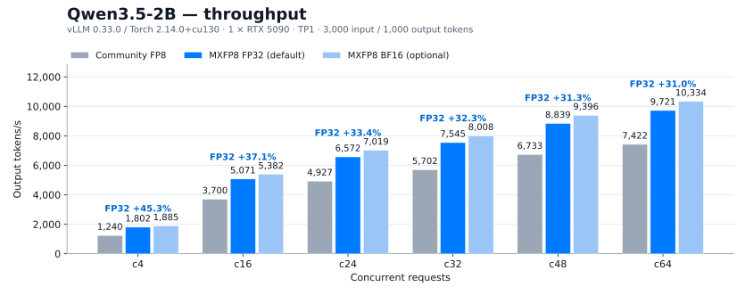
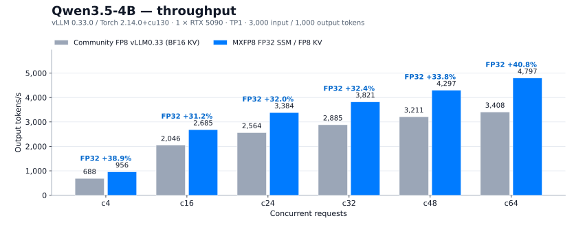
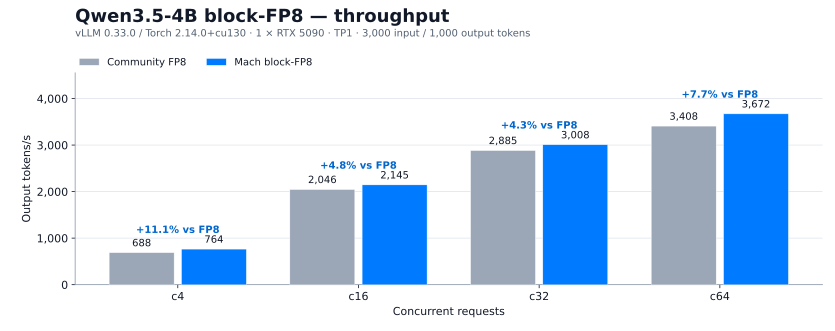
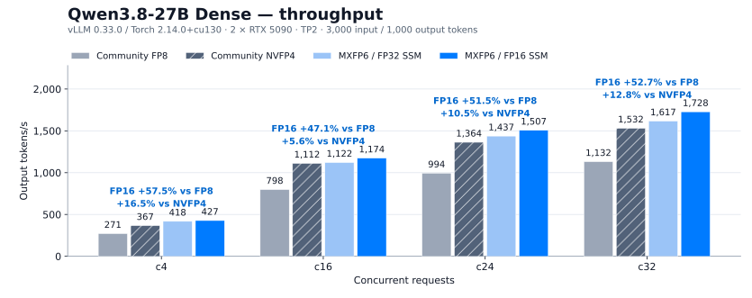
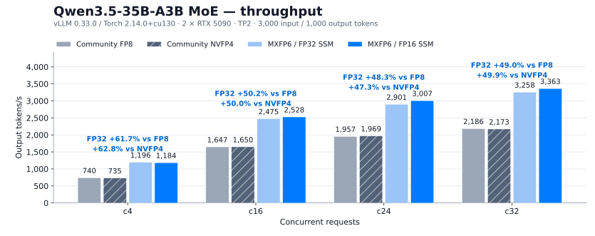

<p align="center">
  <picture>
    <source media="(prefers-color-scheme: dark)" srcset="assets/logo/vllm-mach-horizontal-dark.png">
    
  </picture>
</p>

<p align="center">MXFP6, MXFP8 and block-FP8 inference for vLLM on NVIDIA RTX 5090</p>

<p align="center">
  <a href="https://github.com/troycheng/vllm-mach/releases"></a>
  <a href="LICENSE"></a>
  
</p>

[Mach 0.4.0](https://github.com/troycheng/vllm-mach/releases/tag/v0.4.0) serves Qwen models on **RTX 5090 (SM120)** using vLLM 0.34.0 or 0.33.0. It combines model loading, fusion, recurrent state, attention and CUDA Graphs with the native kernels from [MXFP6 SM120 0.3.2](https://github.com/Nekofish-L/mxfp6_sm120/releases/tag/v0.3.2). Mach also supports existing 4B block-FP8 checkpoints.

<!-- PERFORMANCE:BEGIN -->
## Serving performance

RTX 5090 · 3,000 input / 1,000 output tokens · output tokens/s.

### vLLM 0.34 throughput

2B and 4B run on one GPU. The 27B and 35B models use two GPUs (TP2).

| Model / profile | SSM | Concurrency | vLLM 0.33 | vLLM 0.34 | Change |
|---|---|---:|---:|---:|---:|
| Qwen3.5-2B MXFP8 | FP32 | c16 | 5,157.45 | 5,161.78 | +0.08% |
| Qwen3.5-2B MXFP8 | FP32 | c64 | 9,840.45 | 9,865.12 | +0.25% |
| Qwen3.5-4B MXFP8 | FP32 | c16 | 2,684.51 | 2,777.18 | +3.45% |
| Qwen3.5-4B MXFP8 | FP32 | c64 | 4,796.72 | 4,933.82 | +2.86% |
| Qwen3.5-4B block-FP8 | FP32 | c32 | 3,008.32 | 3,064.28 | +1.86% |
| Qwen3.8-27B Dense MXFP6 FULL | FP16 | c32 | 1,727.78 | 1,726.29 | -0.09% |
| Qwen3.5-35B-A3B MXFP6 | FP16 | c32 | 3,362.91 | 3,354.01 | -0.26% |
| Qwen3.5-35B-A3B MXFP6 compact | FP32 | c128 | 4,902.56 | 4,915.76 | +0.27% |

[Measurements and precision](docs/performance.md#vllm-034-throughput)

### vLLM 0.33.0 concurrency curves

FP32 recurrent state is the default. The performance report includes optional BF16/FP16 state configurations and precision against BF16.

#### Qwen3.5-2B · MXFP8



[Data and precision](docs/performance.md#qwen35-2b) · [Run this profile](docs/mxfp8-2b-champion.md)

#### Qwen3.5-4B · MXFP8



[Data and precision](docs/performance.md#qwen35-4b) · [Run this profile](docs/mxfp8-champion.md)

#### Qwen3.5-4B · block-FP8



[Data and precision](docs/performance.md#qwen35-4b-block-fp8) · [Run this profile](docs/fp8-profile.md)

#### Qwen3.8-27B Dense · MXFP6



[Data and precision](docs/performance.md#qwen38-27b) · [Run this profile](docs/installation.md)

#### Qwen3.5-35B-A3B MoE · MXFP6



[Data and precision](docs/performance.md#qwen35-35b-a3b) · [Run this profile](docs/qwen35-moe.md)

[Historical vLLM 0.29 FP8/NVFP4 comparisons](docs/performance-vllm029.md)

<!-- PERFORMANCE:END -->

## Choose and run a profile

Use Linux x86-64, Python 3.12, Docker Buildx and the NVIDIA container runtime. See [runtime versions](docs/installation.md#runtime-versions).

```bash
git clone --branch v0.4.0 --depth 1 https://github.com/troycheng/vllm-mach.git
cd vllm-mach
```

| Model / checkpoint | Build file | Serving command | Setup |
|---|---|---|---|
| Qwen3.5-2B MXFP8 | `deploy/Dockerfile.mxfp8` | `vllm-mach-mxfp8-2b-serve` | [Prepare and serve](docs/mxfp8-2b-champion.md) |
| Qwen3.5-4B MXFP8 | `deploy/Dockerfile.mxfp8` | `vllm-mach-mxfp8-serve` | [Prepare and serve](docs/mxfp8-champion.md) |
| Qwen3.5-4B block-FP8 | `deploy/Dockerfile.fp8` | `vllm-mach-fp8-serve` | [Existing checkpoint](docs/fp8-profile.md) |
| Qwen3.8-27B MXFP6 | `deploy/Dockerfile` | `vllm-mach-serve` | [Install and launch](docs/installation.md) |
| Qwen3.5-35B-A3B MXFP6 | `deploy/Dockerfile` | `vllm-mach-serve` | [MoE setup](docs/qwen35-moe.md) |

For example, build the shared MXFP8 image and run a [prepared 2B checkpoint](docs/mxfp8-2b-model.md):

```bash
docker buildx build --load --build-arg MAX_JOBS=2 \
  -f deploy/Dockerfile.mxfp8 -t vllm-mach:mxfp8-champion .
mkdir -p "$PWD/runs"
docker run --rm --gpus '"device=0"' --ipc=host -p 8000:8000 \
  --entrypoint vllm-mach-mxfp8-2b-serve \
  -e VLLM_HYBRID_NVFP4_LM_HEAD_CUDAGRAPH=1 \
  -v /absolute/path/to/prepared-2b:/model:ro -v "$PWD/runs:/runs" \
  vllm-mach:mxfp8-champion /model --run-dir /runs/serve --host 0.0.0.0 \
  --attention-backend TRITON_ATTN --ssm-dtype float32 --hybrid-head
```

`--attention-backend TRITON_ATTN` selects the measured 2B path. Use the 2B entrypoint shown above; the shared image defaults to 4B. The server provides an OpenAI-compatible API at `/v1`; `/v1/models` lists the served model name.

This example selects the 2B FP32 default and headgraph ON. Optional BF16 state uses `--ssm-dtype bfloat16`; the headgraph environment variable is independent of the state dtype. Native MXFP6 selects Dense or MoE from `config.json`; append `--fp16-ssm` for FP16 recurrent state. For block-FP8, use `--features n64 ordered silu fa2`. The linked guides include checkpoint preparation and benchmark commands.

`--hybrid-head` supports greedy and eligible unseeded top-k sampling, with optional top-p and presence-only penalties. Other sampling requests use the original sampler. See [sampling support and numerical behavior](docs/lm-head-sampling.md).

## What the selected profiles include

| Profile | Implemented optimizations | Details |
|---|---|---|
| 2B MXFP8 | Native projections; BF16 BA M1–8/M16; ordered FP32 GDN with mixed D1–160; pinned reset-ID uploads; FULL16/FULL24 PDL; padded piecewise graphs through 2048 tokens; Triton attention; K128 hybrid greedy head | [Champion components](docs/mxfp8-2b-champion.md#champion-components) |
| 4B MXFP8 | Dual-activation MLP/QKVZ; M64 pipeline variant; BF16 BA GEMV; ordered GDN; parallel QKVZ/BA; FP8 KV; coarse/refined head; fixed compilation and graph routing | [Complete profile](docs/mxfp8-champion.md#required-parts) |
| 4B block-FP8 | N64 GEMM tiles; ordered low-M GEMM; fused SiLU quantization; mixed FA2; matched RMS compilation choices | [Block-FP8 profile](docs/fp8-profile.md) |
| 27B Dense MXFP6 | Native W6A8; compact greedy sampling; TP2 AllReduce/residual/RMSNorm and activation fusion; persistent GDN; BA overlap; lossless and owner prefill | [Configuration breakdown](docs/dense-gains-aligned-baseline-20260920.md) |
| 35B-A3B MoE MXFP6 | Grouped experts; prefill/decode graphs; compact greedy sampling; fused TP2 communication; GDN integration; projection dispatch at selected row counts from 32 to 160; optional compact expert scheduling at 97–160 rows | [MoE guide and measurements](docs/qwen35-moe.md#compact-moe-at-high-token-counts) |

## Documentation

- [Performance](docs/performance.md): throughput, latency, configurations and precision.
- [Guide index](docs/README.md): installation, model preparation, operator details and development.
- [vLLM 0.29 MXFP8 benchmark](docs/mxfp8-benchmark.md) compares SSM and KV formats against block-FP8.
- [Shared GDN/Mamba runtime](docs/gdn-runtime.md): quantization-independent optimizations, model/path admission and NVFP4 validation.
- [Releases](https://github.com/troycheng/vllm-mach/releases): packages and release notes.

The block-FP8 linear work is also submitted in [vLLM PR #60385](https://github.com/vllm-project/vllm/pull/60385). Mixed FA2 builds on [LiRunGuo's PR #58013](https://github.com/vllm-project/vllm/pull/58013); SiLU quantization work relates to [PR #45055](https://github.com/vllm-project/vllm/pull/45055). Mach includes its integrations directly.

## Contributing and license

See [CONTRIBUTING.md](CONTRIBUTING.md) for performance and correctness evidence expected with changes. [Apache-2.0](LICENSE); derived notices are in [NOTICE](NOTICE). External components retain their own licenses. This project is independent of the vLLM project.
