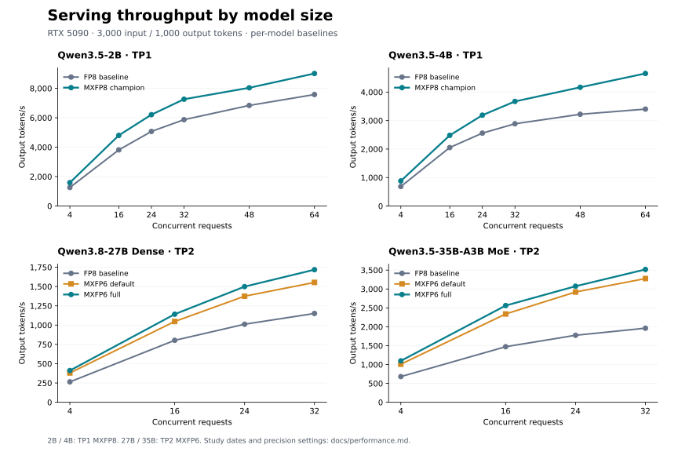

<p align="center">
  <picture>
    <source media="(prefers-color-scheme: dark)" srcset="assets/logo/vllm-mach-horizontal-dark.png">
    
  </picture>
</p>

<p align="center">MXFP6, MXFP8 and block-FP8 inference for vLLM on NVIDIA RTX 5090</p>

<p align="center">
  <a href="https://github.com/troycheng/vllm-mach/releases"></a>
  <a href="LICENSE"></a>
  
</p>

vLLM Mach packages model-specific serving optimizations for **vLLM 0.29.0 on RTX 5090 (SM120)**. The [MXFP6 SM120 library](https://github.com/Nekofish-L/mxfp6_sm120) supplies native MXFP6/MXFP8 kernels; Mach integrates model loading, fusion, recurrent state, attention, graph policies and serving launchers. Existing block-FP8 checkpoints have a separate optimization path.

## Performance by model size

**3,000 input / 1,000 output tokens · output tokens/s · text-only, non-speculative inference.** End-to-end serving on one (TP1) or two (TP2) 32 GiB RTX 5090 GPUs.

| Model / profile | GPUs | Throughput gain vs FP8 | Details |
|---|---|---:|---|
| Qwen3.5-2B · MXFP8 · Triton + hybrid | 1 · TP1 | +17.53% to +25.89% | [Data](docs/performance.md#qwen35-2b) |
| Qwen3.5-4B · MXFP8 champion | 1 · TP1 | +20.83% to +36.77% | [Data](docs/performance.md#qwen35-4b) |
| Qwen3.5-4B block-FP8 · Block-FP8 · all four features | 1 · TP1 | +5.97% to +9.03% | [Data](docs/performance.md#qwen35-4b-block-fp8) |
| Qwen3.8-27B Dense · MXFP6 default / full | 2 · TP2 | default +30.41% to +43.69%; full +42.18% to +55.40% | [Data](docs/performance.md#qwen38-27b) |
| Qwen3.5-35B-A3B MoE · MXFP6 default / full | 2 · TP2 | default +48.34% to +67.01%; full +61.34% to +79.32% | [Data](docs/performance.md#qwen35-35b-a3b) |



See the [performance report](docs/performance.md) for per-concurrency throughput, latency, precision and source data.

MXFP6 **default** uses FP32 recurrent state and BF16 head; **full** adds FP16 state and NVFP4 candidate search with BF16 refinement. The 2B MXFP8 champion keeps BF16 KV and uses Triton attention plus a K128 hybrid head at M≤32. The 4B MXFP8 champion uses calibrated FP8 KV and its own refined head. Numerical results are in the [fidelity table](docs/performance.md#numerical-fidelity).

## Choose and run a profile

Use Linux x86-64, Python 3.12, Docker Buildx and the NVIDIA container runtime. Clone `main`; the 2B/4B profiles were added after the v0.1.1 release.

```bash
git clone https://github.com/troycheng/vllm-mach.git
cd vllm-mach
```

| Model / checkpoint | Build file | Serving command | Setup |
|---|---|---|---|
| Qwen3.5-2B MXFP8 | `deploy/Dockerfile.mxfp8` | `vllm-mach-mxfp8-2b-serve` | [Prepare and serve](docs/mxfp8-2b-champion.md) |
| Qwen3.5-4B MXFP8 | `deploy/Dockerfile.mxfp8` | `vllm-mach-mxfp8-serve` | [Prepare and serve](docs/mxfp8-champion.md) |
| Qwen3.5-4B block-FP8 | `deploy/Dockerfile.fp8` | `vllm-mach-fp8-serve` | [Existing checkpoint](docs/fp8-profile.md) |
| Qwen3.8-27B MXFP6 | `deploy/Dockerfile` | `vllm-mach-serve` | [Install and launch](docs/installation.md) |
| Qwen3.5-35B-A3B MXFP6 | `deploy/Dockerfile` | `vllm-mach-serve` | [MoE setup](docs/qwen35-moe.md) |

For example, build the shared MXFP8 image and run a [prepared 2B checkpoint](docs/mxfp8-2b-model.md):

```bash
docker buildx build --load --build-arg MAX_JOBS=2 \
  -f deploy/Dockerfile.mxfp8 -t vllm-mach:mxfp8-champion .
mkdir -p "$PWD/runs"
docker run --rm --gpus '"device=0"' --ipc=host -p 8000:8000 \
  --entrypoint vllm-mach-mxfp8-2b-serve \
  -v /absolute/path/to/prepared-2b:/model:ro -v "$PWD/runs:/runs" \
  vllm-mach:mxfp8-champion /model --run-dir /runs/serve --host 0.0.0.0 \
  --attention-backend TRITON_ATTN --hybrid-head
```

The two switches select the current 2B champion explicitly. The default shared-image entrypoint serves 4B, so keep the 2B `--entrypoint` override. The server exposes vLLM's OpenAI-compatible API; `/v1/models` lists the served model name.

For native MXFP6, the launcher selects Dense or MoE from `config.json`; append `--fp16-ssm --nvfp4-lm-head` to select full. For block-FP8, use `--features n64 ordered silu fa2`. Each guide includes its checkpoint preparation, exact dependencies, numerical behavior and benchmark command.

## What the selected profiles include

| Profile | Implemented optimizations | Details |
|---|---|---|
| 2B MXFP8 | Native projections; BF16 BA M1–8/M16; ordered FP32 GDN with mixed D1–160; pinned reset-ID uploads; FULL16/FULL24 PDL; exact2048 piecewise graphs; Triton attention; K128 hybrid greedy head | [Champion components](docs/mxfp8-2b-champion.md#champion-components) |
| 4B MXFP8 | Dual-activation MLP/QKVZ; M64 pipeline variant; BF16 BA GEMV; ordered GDN; parallel QKVZ/BA; FP8 KV; coarse/refined head; fixed compilation and graph routing | [Complete profile](docs/mxfp8-champion.md#required-parts) |
| 4B block-FP8 | N64 GEMM tiles; ordered low-M GEMM; fused SiLU quantization; mixed FA2; matched RMS compilation choices | [Block-FP8 profile](docs/fp8-profile.md) |
| 27B Dense MXFP6 | Native W6A8; compact greedy sampling; TP2 AllReduce/residual/RMSNorm and activation fusion; persistent GDN; BA overlap; lossless and owner prefill | [Configuration breakdown](docs/dense-gains-aligned-baseline-20260920.md) |
| 35B-A3B MoE MXFP6 | Grouped experts; prefill/decode graphs; compact greedy sampling; fused TP2 communication; GDN integration; projection dispatch for selected physical rows32–160 | [MoE breakdown](docs/moe-gains-fp8-baseline-20260920.md) |

## Documentation

- [Performance](docs/performance.md): throughput curves, all point values, latency and numerical fidelity.
- [Guide index](docs/README.md): installation, model preparation, operator details and development.
- [Benchmark protocol](docs/mxfp8-benchmark.md): fixed requests, warmup, counts and metrics.
- [History](docs/archive.md): earlier EXL3 work, superseded experiments and release notes.

The block-FP8 linear work is also submitted in [vLLM PR #60385](https://github.com/vllm-project/vllm/pull/60385). Mixed FA2 builds on [LiRunGuo's PR #58013](https://github.com/vllm-project/vllm/pull/58013); SiLU quantization work relates to [PR #45055](https://github.com/vllm-project/vllm/pull/45055). Mach includes its integrations directly.

## Contributing and license

See [CONTRIBUTING.md](CONTRIBUTING.md) for performance and correctness evidence expected with changes. [Apache-2.0](LICENSE); derived notices are in [NOTICE](NOTICE). External components retain their own licenses. This project is independent of the vLLM project.
