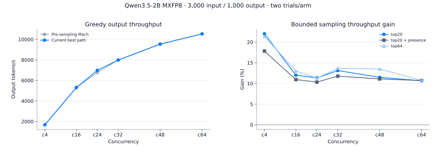
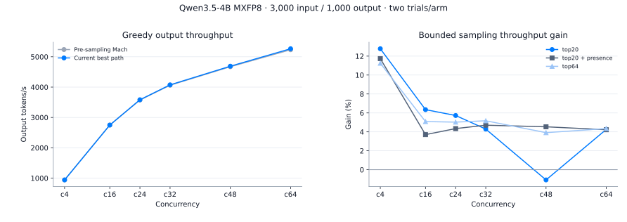
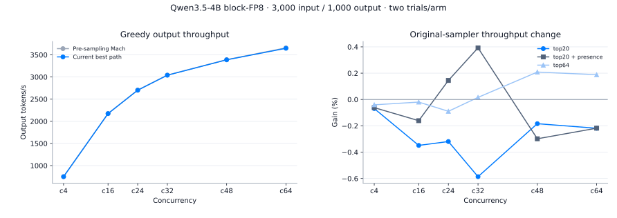

# Best serving paths and sampling recheck — 2026-10-15

This study rechecks the qualified best configurations against Mach
`9d878ad0c35666faef3ddf1aca67b41016ccbc6e`, immediately before the stochastic
LM-head extension, and adds top-k/top-p serving measurements. All new timing
uses **3,000 input / 1,000 output tokens**, text-only inference on RTX 5090.
It is separate from the earlier 1,024/256 head-ablation experiment.

The reported 2B/4B profiles have completed paired measurements. A later
[same-process admission check](#same-process-check-of-unchanged-paths) is recorded
separately below. A startup or build success alone is not a
passed performance or dispatch result. Completed measurements and unsupported
boundaries are recorded below, with sanitized machine-readable data.

## Selected configurations

| Model / weights | GPUs | Selected state / KV | Head and implementation |
|---|---:|---|---|
| Qwen3.5-2B MXFP8 | 1 / TP1 | BF16 ordered SSM / BF16 KV | TRITON_ATTN, K128 hybrid, original BF16 head retained |
| Qwen3.5-4B MXFP8 | 1 / TP1 | BF16 ordered SSM / FP8 E4M3 KV | FLASHINFER, calibrated checkpoint KV scales, K128 compact and K2048 complete head |
| Qwen3.5-4B block-FP8 | 1 / TP1 | FP32 SSM / BF16 KV | n64 + ordered + SiLU + mixed FA2, original complete BF16 head |

“Best” means the selected configuration within its qualified precision and
runtime boundary. It does not mean an exhaustive search across all storage
precisions, compiler recipes or GPUs.

## Controls and workload

Baseline and current use the same checkpoint, GPU(s), serving configuration,
cache sizes, prompts and sampler parameters. Four cold service lifecycles run
baseline/current/current/baseline. MXFP8 current services install the
stochastic extension; greedy requests must retain the original eligible hybrid
path. Block-FP8 retains its original complete head and sampler in both arms:
its separately pinned vLLM profile does not provide the hybrid-head runtime
helpers, so this study does not enable the new extension on that profile.

Profiles are assigned disjoint GPU sets. Host CPU and I/O load are shared with
other jobs and concurrent profile startups; system load is not isolated. The
independent 4B c48 recheck uses separate service lifecycles. This is additional
paired evidence, not a determination of the earlier slowdown's cause.

Concurrency points are c4/16/24/32/48/64. Their greedy scored counts retain
the public six-point protocol: 40/160/120/160/240/320 requests. New stochastic cases
use `max(16, 2c)` scored requests per point, so their statistical support is
reported separately from the longer small-model greedy curve.

Each point has a separate, excluded prewarm of c requests × 256 output tokens,
then an internal warmup of c requests × 128 tokens. Uniform token IDs are in
`[1000, 240000)`. Scored contract seed is `20260924`; greedy request seeds
start at `2026092400`. Stochastic requests omit per-request seeds. All ignore
EOS, disable prefix caching and use the ordinary HTTP streaming interface.

| Case | Temperature | top-k | top-p | Presence penalty |
|---|---:|---:|---:|---:|
| Greedy | 0 | disabled | 1 | 0 |
| top-k20 | 0.7 | 20 | 0.95 | 0 |
| top-k20 + presence | 0.7 | 20 | 0.95 | 1.5 |
| top-k64 | 0.7 | 64 | 0.95 | 0 |
| top-p only | 0.7 | disabled | 0.95 | 0 |
| Unfiltered | 0.7 | disabled | 1 | 0 |

The earlier paired experiment established that the new TP1 unfiltered path
was slower. The best-path policy therefore retains the original TP1 complete
sampler for unfiltered requests. Top-p-only requests also retain the original
sampler because the compact extension requires a small explicit top-k. These
are recorded selections, not claims that every sampling mode uses hybrid.
These receipts used explicit **per-workload flag selection**. After these
measurements, production admission was narrowed to bounded top-k for every TP
layout and enabled by default in the native/MXFP8 launchers. Unfiltered and
top-p-only requests now automatically retain the original sampler even with
the switch enabled; top-k plus presence-only penalties remains admitted.
One shared `--hybrid-head` switch now controls greedy and bounded stochastic
hybrid paths. `--no-hybrid-head` disables both compact paths while retaining
4B's independent K2048 replacement head. `--nvfp4-lm-head` and `--lm-head-sampling` are aliases of this
same switch. The qualification helper retains a diagnostic sampling ablation
to compare with the archived greedy-enabled baseline; that is not a second
production switch.
This subsequent policy change does not rewrite the 2B/4B measurements or their
recorded source hashes. The later same-process native admission check below
tests the updated policy separately; it does not requalify these 2B/4B curves.
Mixed traffic needs its own comparison.

## Dispatch and regression evidence

A named local worker extension exposes a bounded Unix-socket diagnostic
interface. It does not enable arbitrary callable serialization or publish a
network control endpoint. During **excluded prewarm only**, temporary wrappers
count actual coarse NVFP4 projections, BF16 indexed refinement and complete
head use by physical decode rows. All wrappers are removed before internal
warmup and scoring; a regression test verifies exact method restoration.

Eligible greedy and admitted compact sampling must demonstrate actual hybrid
decode calls on every TP rank. Prefill/mixed batches, unsupported sampler
filters, scoring requests and shapes outside the qualified row boundary may
legitimately use the original path. Full graph capture and native/profile
receipts are checked separately; registration alone does not prove dispatch.
For 2B/4B MXFP8 bounded sampling, post-timing counters additionally show
stochastic calls during the timed workload and no NVFP4 admission failures.
Every scored Block-FP8 lifecycle also retains its profile's startup validation:
n64/ordered calls, native SiLU, and coverage of the six pinned RMS compile
bindings. Those counters measure eager/capture invocations, not CUDA Graph
replay executions. This profile keeps its original complete head throughout.

Rates are arithmetic means of two complete lifecycle measurements per arm;
gain is `100 × (current / baseline − 1)`. Raw trial rates and latency accompany
each point. Summary p99 fields average the two per-trial percentiles; they are
not pooled request percentiles. Two measurements do not establish a confidence interval. Any
measured decline is reported, and a decline greater than 3% is a signal for a
fresh review rather than an automatic “no regression” claim. Historical curves
remain separate because hardware load, library revisions and protocol details
can differ between dates.

Continuation after a fully completed lifecycle preserves its records; partially
completed lifecycles explicitly retain separate restart receipts. GPU release
is awaited before the next service starts.

## Same-process check of unchanged paths

The earlier cross-service comparison's lower Greedy, top-p-only and unfiltered
rates are **observed differences, not established code regressions**. Greedy
retains its existing compact hybrid path, while top-p-only and unfiltered
requests retain the original complete head/sampler. The enabled extension does
add CPU admission checks before delegating, so unchanged GPU dispatch alone
does not prove identical performance. The unchanged archived baseline itself
measured 423.23 and 409.41 tokens/s for Greedy c4 across two cold lifecycles, a
3.26% decline relative to its first trial. Cross-service means alone cannot
attribute the earlier differences to the extension.

The follow-up used Qwen3.8-27B MXFP6 on two RTX 5090 GPUs (TP2), vLLM 0.29.0
and Mach `bbb81923c544d95a0bcca5e12d60cf7ecd1a3652`. Its serving code is unchanged
from `57229e4b89da23173b3e32aa1e5782eade28150d`. The existing native full profile
retained FP16 SSM, BF16 KV, the BF16 head, TRITON_ATTN, 8 GiB KV per rank,
32 maximum sequences, 16,384 maximum context tokens and 4,096 batched tokens.
Compilation mode was `NONE`, with `FULL_DECODE_ONLY` graphs at
1/2/4/8/16/24/32 tokens.

One warm service alternated **only the internal stochastic-admission flag**
while idle between cohorts. Existing Greedy hybrid stayed enabled throughout;
this is not an on/off comparison of the public `--hybrid-head` switch. Both
arms retained the installed wrapper and the same process, checkpoint, graph
captures and caches. Greedy and unfiltered used off/on/on/off order;
top-p-only used on/off/off/on.

Each of the 12 scored cohorts used concurrency 4 and 16 requests, each with
3,000 input / 1,000 output tokens: 192 requests and 192,000 output tokens in
total. Sampling parameters and prompt/seed contracts match the cases above.
Each mode first ran an excluded full-shape 16-request warmup; each scored cohort
also had four excluded 128-token warmup requests. Audit wrappers were absent
during timing, stochastic-path counters stayed unchanged on both ranks and no
logged inference-JIT warning overlapped an accepted scoring interval. All
requests completed with the contracted token counts. These checks establish
dispatch and completion, not a new numerical-fidelity or answer-accuracy result.

| Mode | Admission off tokens/s | Admission on tokens/s | Difference |
|---|---:|---:|---:|
| Greedy | 408.79 | 408.80 | +0.003% |
| top-p only | 367.36 | 367.43 | +0.017% |
| Unfiltered | 381.01 | 381.01 | +0.001% |

Rates are arithmetic means of two cohorts per setting. **This same-process c4
check did not reproduce the earlier slowdown**; differences below 0.02% are
not evidence of a speedup. The earlier roughly 1–2% cross-service differences
cannot be attributed to the new admission checks on this evidence. Their full
cause remains unresolved: this check does not isolate every startup-state
effect, establish a confidence interval, or demonstrate no regression at all
concurrencies, models or mixed workloads. It also does not replace a comparison
against archived source. The test service was stopped after measurement.

[Sanitized per-cohort rates, latency, workload and validation checks](data/lm-head-admission-check-20261015.json).
The original 2B/4B results and frozen source identities below remain unchanged.

## Results

Two lifecycle measurements per arm are required for every comparison below.
Completed points include all six modes; unpaired points remain pending.

| Profile | Completed points | Status |
|---|---:|---|
| Qwen3.5-2B MXFP8 | 144/144 | Complete |
| Qwen3.5-4B MXFP8 | 144/144 | Complete |
| Qwen3.5-4B block-FP8 | 144/144 | Complete |

### Qwen3.5-2B MXFP8



| Mode | Concurrency | Baseline tokens/s | Current tokens/s | Gain | Current TTFT ms | Current TPOT ms |
|---|---:|---:|---:|---:|---:|---:|
| greedy | c4 | 1678.50 | 1691.38 | +0.77% | 98.05 | 2.269 |
| greedy | c16 | 5311.20 | 5308.74 | -0.05% | 134.85 | 2.879 |
| greedy | c24 | 6773.95 | 6984.25 | +3.10% | 177.88 | 3.253 |
| greedy | c32 | 7983.81 | 7992.40 | +0.11% | 207.42 | 3.788 |
| greedy | c48 | 9524.66 | 9541.46 | +0.18% | 263.24 | 4.752 |
| greedy | c64 | 10541.45 | 10535.21 | -0.06% | 321.33 | 5.731 |
| top20 | c4 | 1277.59 | 1558.77 | +22.01% | 98.40 | 2.469 |
| top20 | c16 | 4417.91 | 4947.95 | +12.00% | 211.31 | 3.011 |
| top20 | c24 | 5856.15 | 6521.80 | +11.37% | 276.44 | 3.384 |
| top20 | c32 | 6754.40 | 7640.72 | +13.12% | 346.66 | 3.813 |
| top20 | c48 | 8359.04 | 9318.94 | +11.48% | 486.65 | 4.617 |
| top20 | c64 | 9323.63 | 10317.03 | +10.65% | 616.88 | 5.518 |
| top20_presence | c4 | 1274.44 | 1501.58 | +17.82% | 99.27 | 2.566 |
| top20_presence | c16 | 4411.28 | 4893.68 | +10.94% | 203.12 | 3.055 |
| top20_presence | c24 | 5838.78 | 6441.64 | +10.33% | 274.30 | 3.431 |
| top20_presence | c32 | 6788.13 | 7587.78 | +11.78% | 347.38 | 3.841 |
| top20_presence | c48 | 8287.56 | 9206.84 | +11.09% | 479.35 | 4.686 |
| top20_presence | c64 | 9227.72 | 10214.58 | +10.69% | 618.41 | 5.575 |
| top64 | c4 | 1283.15 | 1557.21 | +21.36% | 101.05 | 2.469 |
| top64 | c16 | 4384.33 | 4955.00 | +13.02% | 204.82 | 3.013 |
| top64 | c24 | 5865.65 | 6528.96 | +11.31% | 277.48 | 3.379 |
| top64 | c32 | 6799.70 | 7730.38 | +13.69% | 342.22 | 3.769 |
| top64 | c48 | 8151.55 | 9251.95 | +13.50% | 477.11 | 4.664 |
| top64 | c64 | 9188.55 | 10177.88 | +10.77% | 627.28 | 5.592 |
| topp | c4 | 1292.44 | 1298.83 | +0.49% | 99.22 | 2.982 |
| topp | c16 | 4318.25 | 4317.43 | -0.02% | 205.88 | 3.486 |
| topp | c24 | 5749.07 | 5681.41 | -1.18% | 268.78 | 3.932 |
| topp | c32 | 6669.73 | 6623.48 | -0.69% | 342.30 | 4.455 |
| topp | c48 | 8113.88 | 8146.22 | +0.40% | 481.84 | 5.353 |
| topp | c64 | 8930.68 | 9096.34 | +1.85% | 633.88 | 6.320 |
| full | c4 | 1483.94 | 1483.83 | -0.01% | 101.40 | 2.596 |
| full | c16 | 4580.84 | 4581.76 | +0.02% | 202.00 | 3.277 |
| full | c24 | 6053.81 | 6058.67 | +0.08% | 274.43 | 3.665 |
| full | c32 | 7045.75 | 7060.26 | +0.21% | 338.11 | 4.164 |
| full | c48 | 8605.37 | 8609.17 | +0.04% | 465.54 | 5.058 |
| full | c64 | 9550.30 | 9512.22 | -0.40% | 614.58 | 6.038 |

Worst measured change: **-1.18%**, topp c24.
Eligible greedy and enabled bounded-sampling audits on every rank recorded
hybrid decode and zero complete-head decode calls; prefill/mixed calls are excluded.

### Qwen3.5-4B MXFP8



| Mode | Concurrency | Baseline tokens/s | Current tokens/s | Gain | Current TTFT ms | Current TPOT ms |
|---|---:|---:|---:|---:|---:|---:|
| greedy | c4 | 941.92 | 940.91 | -0.11% | 173.77 | 4.080 |
| greedy | c16 | 2751.22 | 2748.79 | -0.09% | 236.25 | 5.585 |
| greedy | c24 | 3575.00 | 3583.70 | +0.24% | 345.68 | 6.342 |
| greedy | c32 | 4062.41 | 4074.83 | +0.31% | 418.81 | 7.420 |
| greedy | c48 | 4672.32 | 4689.98 | +0.38% | 531.94 | 9.677 |
| greedy | c64 | 5232.76 | 5265.18 | +0.62% | 702.53 | 11.413 |
| top20 | c4 | 827.95 | 933.74 | +12.78% | 182.80 | 4.103 |
| top20 | c16 | 2557.84 | 2720.10 | +6.34% | 411.70 | 5.452 |
| top20 | c24 | 3357.33 | 3549.55 | +5.73% | 582.44 | 6.147 |
| top20 | c32 | 3872.15 | 4038.23 | +4.29% | 738.37 | 7.139 |
| top20 | c48 | 4471.99 | 4423.70 | -1.08% | 1208.59 | 9.262 |
| top20 | c64 | 4992.04 | 5204.79 | +4.26% | 1383.52 | 10.797 |
| top20_presence | c4 | 833.67 | 931.49 | +11.73% | 186.42 | 4.110 |
| top20_presence | c16 | 2587.27 | 2683.16 | +3.71% | 435.99 | 5.510 |
| top20_presence | c24 | 3353.70 | 3499.36 | +4.34% | 589.27 | 6.237 |
| top20_presence | c32 | 3844.08 | 4024.81 | +4.70% | 719.52 | 7.185 |
| top20_presence | c48 | 4431.77 | 4632.69 | +4.53% | 1020.34 | 9.262 |
| top20_presence | c64 | 4967.13 | 5176.89 | +4.22% | 1372.72 | 10.873 |
| top64 | c4 | 835.34 | 929.27 | +11.24% | 184.10 | 4.122 |
| top64 | c16 | 2577.33 | 2708.37 | +5.08% | 413.96 | 5.475 |
| top64 | c24 | 3361.24 | 3530.17 | +5.03% | 574.25 | 6.192 |
| top64 | c32 | 3835.63 | 4033.93 | +5.17% | 725.59 | 7.160 |
| top64 | c48 | 4460.28 | 4634.86 | +3.91% | 1021.60 | 9.256 |
| top64 | c64 | 4996.24 | 5213.39 | +4.35% | 1368.23 | 10.791 |
| topp | c4 | 838.49 | 843.30 | +0.57% | 181.63 | 4.564 |
| topp | c16 | 2532.79 | 2563.71 | +1.22% | 415.24 | 5.805 |
| topp | c24 | 3324.49 | 3328.97 | +0.13% | 561.67 | 6.612 |
| topp | c32 | 3835.42 | 3829.83 | -0.15% | 718.83 | 7.586 |
| topp | c48 | 4406.94 | 4388.63 | -0.42% | 1021.72 | 9.831 |
| topp | c64 | 4945.64 | 4956.92 | +0.23% | 1357.20 | 11.429 |
| full | c4 | 924.57 | 918.07 | -0.70% | 181.91 | 4.177 |
| full | c16 | 2660.02 | 2625.52 | -1.30% | 425.15 | 5.650 |
| full | c24 | 3464.09 | 3433.36 | -0.89% | 563.82 | 6.393 |
| full | c32 | 3937.77 | 3935.18 | -0.07% | 717.91 | 7.366 |
| full | c48 | 4522.40 | 4511.23 | -0.25% | 1022.00 | 9.536 |
| full | c64 | 5053.87 | 5046.68 | -0.14% | 1343.61 | 11.217 |

Worst measured change: **-1.30%**, full c16.
Eligible greedy and enabled bounded-sampling audits on every rank recorded
hybrid decode and zero complete-head decode calls; prefill/mixed calls are excluded.

### Qwen3.5-4B block-FP8



| Mode | Concurrency | Baseline tokens/s | Current tokens/s | Gain | Current TTFT ms | Current TPOT ms |
|---|---:|---:|---:|---:|---:|---:|
| greedy | c4 | 750.32 | 750.45 | +0.02% | 189.38 | 5.145 |
| greedy | c16 | 2174.84 | 2173.83 | -0.05% | 251.53 | 7.109 |
| greedy | c24 | 2705.26 | 2701.31 | -0.15% | 371.67 | 8.502 |
| greedy | c32 | 3043.40 | 3040.14 | -0.11% | 443.86 | 10.064 |
| greedy | c48 | 3391.71 | 3387.54 | -0.12% | 584.62 | 13.550 |
| greedy | c64 | 3657.40 | 3647.68 | -0.27% | 781.38 | 16.708 |
| top20 | c4 | 689.83 | 689.36 | -0.07% | 202.72 | 5.603 |
| top20 | c16 | 2102.86 | 2095.53 | -0.35% | 459.70 | 7.151 |
| top20 | c24 | 2621.63 | 2613.26 | -0.32% | 633.66 | 8.506 |
| top20 | c32 | 2959.22 | 2941.87 | -0.59% | 789.43 | 10.024 |
| top20 | c48 | 3318.06 | 3311.96 | -0.18% | 1129.40 | 13.253 |
| top20 | c64 | 3572.49 | 3564.67 | -0.22% | 1495.72 | 16.289 |
| top20_presence | c4 | 689.18 | 688.75 | -0.06% | 203.59 | 5.607 |
| top20_presence | c16 | 2106.09 | 2102.70 | -0.16% | 459.22 | 7.125 |
| top20_presence | c24 | 2613.29 | 2617.07 | +0.14% | 622.87 | 8.504 |
| top20_presence | c32 | 2932.84 | 2944.35 | +0.39% | 786.80 | 10.018 |
| top20_presence | c48 | 3306.76 | 3296.89 | -0.30% | 1137.66 | 13.311 |
| top20_presence | c64 | 3551.35 | 3543.62 | -0.22% | 1496.72 | 16.394 |
| top64 | c4 | 686.56 | 686.28 | -0.04% | 201.22 | 5.630 |
| top64 | c16 | 2106.42 | 2106.01 | -0.02% | 458.23 | 7.114 |
| top64 | c24 | 2623.55 | 2621.20 | -0.09% | 627.58 | 8.485 |
| top64 | c32 | 2946.66 | 2947.13 | +0.02% | 789.89 | 10.004 |
| top64 | c48 | 3304.26 | 3311.15 | +0.21% | 1125.34 | 13.261 |
| top64 | c64 | 3558.71 | 3565.41 | +0.19% | 1492.54 | 16.289 |
| topp | c4 | 693.49 | 691.26 | -0.32% | 197.61 | 5.592 |
| topp | c16 | 2086.55 | 2070.69 | -0.76% | 464.55 | 7.238 |
| topp | c24 | 2594.20 | 2584.85 | -0.36% | 627.76 | 8.613 |
| topp | c32 | 2928.16 | 2922.90 | -0.18% | 790.74 | 10.094 |
| topp | c48 | 3286.90 | 3275.24 | -0.35% | 1134.86 | 13.410 |
| topp | c64 | 3538.17 | 3536.09 | -0.06% | 1502.90 | 16.427 |
| full | c4 | 747.74 | 747.42 | -0.04% | 196.74 | 5.158 |
| full | c16 | 2146.13 | 2147.41 | +0.06% | 463.21 | 6.964 |
| full | c24 | 2650.42 | 2647.96 | -0.09% | 627.78 | 8.394 |
| full | c32 | 2980.46 | 2989.55 | +0.30% | 785.38 | 9.857 |
| full | c48 | 3349.37 | 3347.04 | -0.07% | 1126.66 | 13.108 |
| full | c64 | 3599.84 | 3600.69 | +0.02% | 1486.80 | 16.124 |

Worst measured change: **-0.76%**, topp c16.

### Independent 4B top-k20 c48 confirmation

The original matrix retains its measured −1.08% mean at this point; one
current trial was 4,189.18 tokens/s versus 4,658.22 in the other trial.
A separate baseline/current/current/baseline recheck uses the same
3,000/1,000 workload and flag selection. It does not replace the matrix.

| Baseline tokens/s | Current tokens/s | Gain |
|---:|---:|---:|
| 4554.02 | 4726.16 | +3.78% |

[Machine-readable trials, latency and dispatch evidence](data/best-path-recheck-20261015.json).

## Reproduction

Use the corresponding independently installed runtime profile and a read-only
checkpoint. Archive the pre-sampling Mach revision into a separate directory;
keep the current checkout and its runtime unchanged during a paired run.

```bash
python tools/retest_best_paths.py --profile 2b-mxfp8 \
  --model /models/PREPARED-2B --baseline-root /checkouts/PRE-SAMPLING-MACH \
  --devices 0 --output /results/2b-best-path --port 8140
```

Use `4b-mxfp8` or `4b-block-fp8` for the other profiles in this report. Match
the runtime environment to the profile; each startup checks that its GPU is idle.
`--cases` and `--points` select explicit subsets. Incomplete subsets must not
be presented as full qualification.
`--resume` retains completed points and records newly started service lifecycles
in separate directories after an interrupted run.

Sampling-distribution fidelity and seeded/logprob fallback checks from the
preceding study remain in [the head report](lm-head-sampling.md). They do not
establish business answer accuracy or qualify every configuration in this new
performance matrix.

## Greedy repeatability is separate from numerical fidelity

Full 1,000-token greedy response text matched in 2,061/2,080 paired 2B requests
(99.09%) and 1,943/2,080 paired 4B requests (93.41%). The unchanged baseline's
own two lifecycles matched in 1,030/1,040 2B requests (99.04%) and 964/1,040 4B
requests (92.69%); current/current repeats matched 99.13% and 97.40% respectively.
These HTTP runs use dynamic batching and do not hold each decode state's
physical geometry fixed. They therefore establish neither bitwise generation
parity nor a change in answer accuracy. Numerical distribution/fallback checks
use the separate fixed-cohort procedure in the head study. No raw response text
is published in this report.
