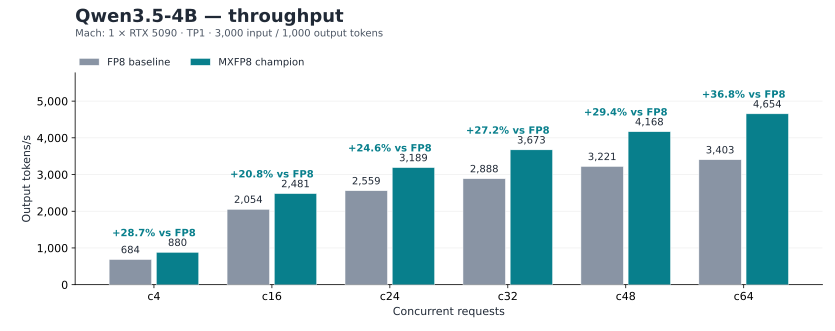

# MXFP8 serving benchmark

Qwen3.5-2B and Qwen3.5-4B on one RTX 5090 per model, TP1. Each table reports **output tokens/s at an individual request concurrency** and compares that configuration with the historical open-source **block FP8** reference.

Launcher defaults: 4B uses **FP32 SSM / FP8 E4M3 KV** when both dtype flags are omitted. Changing the default GDN backend to ordered does not change either storage dtype. 2B fixes KV to BF16. Stock vLLM defaults to `auto` (model dtype). The 4B baseline explicitly passes `--kv-cache-dtype bfloat16`.

The baseline is **FP32 SSM state and BF16 KV**, with MXFP8 model weights. SSM precision reduction means FP32 to BF16; KV quantization means BF16 to E4M3 FP8. The main 4B configuration keeps FP32 SSM with FP8 KV; BF16 SSM is optional. The 2B matrix retains BF16 KV.

Current MXFP8 measurements use native revision `ce0cd05` and the same fused SwiGLU/MXFP8 quantization and hybrid greedy-head optimizations. The production graph and PDL selectors remain active. Both SSM dtypes use ordered GDN in the main matrix; BF16 rounds dense state after each pending token. Stock BF16 comparisons remain in the recheck section.

Block FP8 values are retained historical open-source measurements, not fresh paired trials. The 2B reference used another RTX 5090. Gains describe complete configurations; single-run differences have no repeated-trial confidence interval.

[Machine-readable data](data/mxfp8-benchmark.json) retain exact rates, per-point latency metrics, request counts, artifact hashes and runtime receipts.

## Qwen3.5-4B



### FP32 SSM / BF16 KV

| Concurrency | Open-source block FP8 | MXFP8 | Gain vs block FP8 |
|---:|---:|---:|---:|
| c4 | 683.96 | 936.10 | +36.86% |
| c16 | 2053.55 | 2502.17 | +21.85% |
| c24 | 2559.26 | 3102.36 | +21.22% |
| c32 | 2887.82 | 3464.07 | +19.95% |
| c48 | 3220.55 | 3909.08 | +21.38% |
| c64 | 3402.76 | 4199.28 | +23.41% |

Launch flags: `--ssm-dtype float32 --kv-cache-dtype bfloat16`.

### FP32 SSM / FP8 KV (launcher default)

| Concurrency | Open-source block FP8 | MXFP8 | Gain vs block FP8 |
|---:|---:|---:|---:|
| c4 | 683.96 | 957.38 | +39.98% |
| c16 | 2053.55 | 2713.33 | +32.13% |
| c24 | 2559.26 | 3432.69 | +34.13% |
| c32 | 2887.82 | 3889.65 | +34.69% |
| c48 | 3220.55 | 4396.73 | +36.52% |
| c64 | 3402.76 | 4867.51 | +43.05% |

Launch flags: `--ssm-dtype float32 --kv-cache-dtype fp8_e4m3`.

### BF16 ordered SSM / BF16 KV

| Concurrency | Open-source block FP8 | MXFP8 | Gain vs block FP8 |
|---:|---:|---:|---:|
| c4 | 683.96 | 954.55 | +39.56% |
| c16 | 2053.55 | 2618.42 | +27.51% |
| c24 | 2559.26 | 3265.26 | +27.59% |
| c32 | 2887.82 | 3673.46 | +27.21% |
| c48 | 3220.55 | 4184.79 | +29.94% |
| c64 | 3402.76 | 4546.59 | +33.62% |

Launch flags: `--ssm-dtype bfloat16 --ordered-bf16-ssm --kv-cache-dtype bfloat16`.

### BF16 ordered SSM / FP8 KV

| Concurrency | Open-source block FP8 | MXFP8 | Gain vs block FP8 |
|---:|---:|---:|---:|
| c4 | 683.96 | 980.42 | +43.34% |
| c16 | 2053.55 | 2861.86 | +39.36% |
| c24 | 2559.26 | 3668.42 | +43.34% |
| c32 | 2887.82 | 4179.18 | +44.72% |
| c48 | 3220.55 | 4777.60 | +48.35% |
| c64 | 3402.76 | 5373.24 | +57.91% |

Launch flags: `--ssm-dtype bfloat16 --ordered-bf16-ssm --kv-cache-dtype fp8_e4m3`.

## Qwen3.5-2B


### FP32 SSM / BF16 KV

| Concurrency | Open-source block FP8 | MXFP8 | Gain vs block FP8 |
|---:|---:|---:|---:|
| c4 | 1261.89 | 1682.89 | +33.36% |
| c16 | 3814.33 | 5134.27 | +34.60% |
| c24 | 5069.68 | 6631.15 | +30.80% |
| c32 | 5870.22 | 7610.93 | +29.65% |
| c48 | 6837.60 | 8963.55 | +31.09% |
| c64 | 7578.86 | 9811.23 | +29.46% |

Launch flags: `--ssm-dtype float32`.

### BF16 ordered SSM / BF16 KV

| Concurrency | Open-source block FP8 | MXFP8 | Gain vs block FP8 |
|---:|---:|---:|---:|
| c4 | 1261.89 | 1720.48 | +36.34% |
| c16 | 3814.33 | 5406.61 | +41.74% |
| c24 | 5069.68 | 7086.18 | +39.78% |
| c32 | 5870.22 | 8086.39 | +37.75% |
| c48 | 6837.60 | 9547.91 | +39.64% |
| c64 | 7578.86 | 10463.62 | +38.06% |

Launch flags: `--ssm-dtype bfloat16 --ordered-bf16-ssm`.

## Baseline and BF16 GDN recheck

2B variants run sequentially on GPU 2 and 4B variants sequentially on GPU 3. Each uses a fresh service and the same updated native binary, prompts, graph policy and KV budget. Grouped BF16 GDN and GDN PDL are disabled in these tables; production projection PDL remains unchanged. The 4B BF16 stock and ordered rates below have been refreshed by the complete recheck described in the next section. The 4B FP32 baseline is also refreshed by the paired dtype recheck. The 2B rates retain the preceding measurements.

Worker receipts confirm FP32 state and ready ordered GDN for the baseline, BF16 state and ready ordered GDN for the main BF16 matrix. Stock measurements are retained below as an explicit backend comparison. The main five configuration tables above use this recheck. The earlier raw matrix remains archived.

Change from the preceding matrix baseline (same configuration, different GPU):

| Concurrency | 2B FP32 / BF16 KV | 4B FP32 / BF16 KV |
|---:|---:|---:|
| c4 | -1.01% | +0.18% |
| c16 | +2.52% | +0.10% |
| c24 | +2.38% | +0.04% |
| c32 | +2.08% | +0.11% |
| c48 | +2.30% | +0.28% |
| c64 | +2.21% | +0.52% |

The dtype, cache and GDN route checks pass in both runs. Cross-card differences above describe observed variability; the state comparisons below use the fresh baseline on the same GPU.

### 2B route comparison (output tokens/s)

| Concurrency | FP32 / BF16 KV | BF16 stock / BF16 KV | BF16 ordered / BF16 KV |
|---:|---:|---:|---:|
| c4 | 1682.89 | 1696.51 | 1720.48 |
| c16 | 5134.27 | 5318.61 | 5406.61 |
| c24 | 6631.15 | 6929.11 | 7086.18 |
| c32 | 7610.93 | 7884.13 | 8086.39 |
| c48 | 8963.55 | 9378.64 | 9547.91 |
| c64 | 9811.23 | 10182.11 | 10463.62 |

### 4B route comparison (output tokens/s)

| Concurrency | FP32 / BF16 KV | BF16 stock / BF16 KV | BF16 ordered / BF16 KV | BF16 stock / FP8 KV | BF16 ordered / FP8 KV |
|---:|---:|---:|---:|---:|---:|
| c4 | 936.10 | 957.47 | 954.55 | 981.24 | 980.42 |
| c16 | 2502.17 | 2634.46 | 2618.42 | 2874.11 | 2861.86 |
| c24 | 3102.36 | 3308.59 | 3265.26 | 3694.97 | 3668.42 |
| c32 | 3464.07 | 3736.70 | 3673.46 | 4243.07 | 4179.18 |
| c48 | 3909.08 | 4240.64 | 4184.79 | 4853.96 | 4777.60 |
| c64 | 4199.28 | 4585.55 | 4546.59 | 5385.05 | 5373.24 |

### 4B SSM precision with FP8 KV held fixed (GPU 4)

Both services ran sequentially on GPU 4 in the preceding recheck. This pair compares the complete FP32 ordered versus BF16 stock configurations at the same KV dtype, matching the October 12 SSM study. It uses a different GPU from the main matrix.

| Concurrency | FP32 SSM / FP8 KV | BF16 stock SSM / FP8 KV | BF16 vs FP32 | October 12 gain |
|---:|---:|---:|---:|---:|
| c4 | 954.83 | 977.42 | +2.37% | +2.21% |
| c16 | 2704.38 | 2860.95 | +5.79% | +5.00% |
| c24 | 3419.20 | 3676.16 | +7.52% | +8.15% |
| c32 | 3868.28 | 4208.84 | +8.80% | +9.15% |
| c48 | 4361.85 | 4800.04 | +10.05% | +10.42% |
| c64 | 4824.72 | 5318.65 | +10.24% | +10.61% |

### 4B historical configuration alignment

The October 13 previous-ordered run used **BF16 SSM / FP8 E4M3 KV**, confirmed by its archived launcher argv. It was not a BF16 KV measurement. The current BF16 KV row is a separate configuration required by the unquantized-KV matrix. Only the FP8 KV columns below use matching SSM/KV/backend settings; native revision and GPU still differ between dates.

| Concurrency | Historical ordered / FP8 KV | Current ordered / FP8 KV | Change at matching dtype | Current ordered / BF16 KV |
|---:|---:|---:|---:|---:|
| c4 | 936.45 | 980.42 | +4.70% | 954.55 |
| c16 | 2741.93 | 2861.86 | +4.37% | 2618.42 |
| c24 | 3573.93 | 3668.42 | +2.64% | 3265.26 |
| c32 | 4085.16 | 4179.18 | +2.30% | 3673.46 |
| c48 | 4705.02 | 4777.60 | +1.54% | 4184.79 |
| c64 | 5275.68 | 5373.24 | +1.85% | 4546.59 |

To select BF16 SSM and BF16 KV explicitly, use `--ssm-dtype bfloat16 --kv-cache-dtype bfloat16`. To reproduce the historical dtype/backend selection, use `--ssm-dtype bfloat16 --kv-cache-dtype fp8_e4m3 --ordered-bf16-ssm`. Grouped BF16 GDN and GDN PDL remain disabled in this previous-ordered comparison.

At c64, 2B ordered BF16 reaches **10463.62 tokens/s**, versus **10182.11** for current stock BF16 and **10472.36** for the October 13 ordered run (-0.08% versus that historical run). The default backend now selects this ordered configuration; use `--no-ordered-bf16-ssm` to reproduce stock GDN.

The October 13 GDN study used stock/ordered/grouped BF16 routes, BF16 KV for 2B and FP8 KV for 4B, with an earlier native binary (`c4522aff…`). Its runtime source hashes match the current runtime; native binary, GPU and route differences prevent attributing changes to SSM precision alone. Ordered BF16 retains the unresolved correctness limitations described in the [GDN guide](mxfp8-gdn.md).

## October 14 complete 4B BF16 SSM throughput recheck

All six concurrency points use fresh services sequentially on GPU 3 (RTX 5090), the same native binary, 3000 input / 1000 output tokens, fixed prompts, graph policy and KV memory budget. Each route completes 1,040 scored requests per KV dtype. Production projection PDL stays enabled. The ordered default route disables grouped GDN and GDN PDL; the grouped+PDL route enables both experimental switches.

### BF16 KV (output tokens/s)

| Concurrency | Stock BF16 | Ordered default | Ordered vs stock | Grouped + PDL | Grouped + PDL vs stock | Grouped + PDL vs ordered |
|---:|---:|---:|---:|---:|---:|---:|
| c4 | 957.47 | 954.55 | -0.30% | 955.76 | -0.18% | +0.13% |
| c16 | 2634.46 | 2618.42 | -0.61% | 2625.83 | -0.33% | +0.28% |
| c24 | 3308.59 | 3265.26 | -1.31% | 3271.52 | -1.12% | +0.19% |
| c32 | 3736.70 | 3673.46 | -1.69% | 3678.45 | -1.56% | +0.14% |
| c48 | 4240.64 | 4184.79 | -1.32% | 4203.39 | -0.88% | +0.44% |
| c64 | 4585.55 | 4546.59 | -0.85% | 4567.55 | -0.39% | +0.46% |

### FP8 E4M3 KV (output tokens/s)

| Concurrency | Stock BF16 | Ordered default | Ordered vs stock | Grouped + PDL | Grouped + PDL vs stock | Grouped + PDL vs ordered |
|---:|---:|---:|---:|---:|---:|---:|
| c4 | 981.24 | 980.42 | -0.08% | 980.56 | -0.07% | +0.01% |
| c16 | 2874.11 | 2861.86 | -0.43% | 2877.04 | +0.10% | +0.53% |
| c24 | 3694.97 | 3668.42 | -0.72% | 3675.02 | -0.54% | +0.18% |
| c32 | 4243.07 | 4179.18 | -1.51% | 4202.44 | -0.96% | +0.56% |
| c48 | 4853.96 | 4777.60 | -1.57% | 4801.66 | -1.08% | +0.50% |
| c64 | 5385.05 | 5373.24 | -0.22% | 5391.64 | +0.12% | +0.34% |

### Ordered default change from the preceding matrix

The preceding ordered measurements used the same GPU and request protocol. These are separate service runs; changes include run variability and do not isolate the kernel change. The main 4B BF16 tables and chart above now use the latest ordered-default results.

| Concurrency | Previous BF16 KV | Latest BF16 KV | Change | Previous FP8 KV | Latest FP8 KV | Change |
|---:|---:|---:|---:|---:|---:|---:|
| c4 | 953.88 | 954.55 | +0.07% | 978.79 | 980.42 | +0.17% |
| c16 | 2619.71 | 2618.42 | -0.05% | 2862.04 | 2861.86 | -0.01% |
| c24 | 3260.84 | 3265.26 | +0.14% | 3630.11 | 3668.42 | +1.06% |
| c32 | 3665.11 | 3673.46 | +0.23% | 4153.06 | 4179.18 | +0.63% |
| c48 | 4175.26 | 4184.79 | +0.23% | 4770.53 | 4777.60 | +0.15% |
| c64 | 4546.23 | 4546.59 | +0.01% | 5367.96 | 5373.24 | +0.10% |

These are single full-curve runs per route, with no repeated-trial confidence interval. Grouped GDN and GDN PDL remain experimental and disabled by default. See the [GDN guide](mxfp8-gdn.md) for correctness qualification. Raw request records and worker receipts are referenced in the machine-readable dataset.

## October 14 paired 4B dtype and attention throughput

Fresh sequential services on GPU 3 use the same binary, runtime, prompts, 19 GiB KV budget, graph policy and 3000-input/1000-output protocol. Each configuration completes all six points and 1,040 scored requests. Ordered GDN is used throughout; grouped GDN and GDN PDL are disabled. Both KV dtypes use BF16 queries, native FlashInfer prefill and XQA decode in the default runs.

| Concurrency | FP32 SSM / BF16 KV | BF16 SSM / BF16 KV | SSM gain with BF16 KV | FP32 SSM / FP8 KV | BF16 SSM / FP8 KV | SSM gain with FP8 KV | KV gain with FP32 SSM | KV gain with BF16 SSM | Combined gain |
|---:|---:|---:|---:|---:|---:|---:|---:|---:|---:|
| c4 | 936.10 | 954.55 | +1.97% | 957.38 | 980.42 | +2.41% | +2.27% | +2.71% | +4.73% |
| c16 | 2502.17 | 2618.42 | +4.65% | 2713.33 | 2861.86 | +5.47% | +8.44% | +9.30% | +14.38% |
| c24 | 3102.36 | 3265.26 | +5.25% | 3432.69 | 3668.42 | +6.87% | +10.65% | +12.35% | +18.25% |
| c32 | 3464.07 | 3673.46 | +6.04% | 3889.65 | 4179.18 | +7.44% | +12.29% | +13.77% | +20.64% |
| c48 | 3909.08 | 4184.79 | +7.05% | 4396.73 | 4777.60 | +8.66% | +12.47% | +14.17% | +22.22% |
| c64 | 4199.28 | 4546.59 | +8.27% | 4867.51 | 5373.24 | +10.39% | +15.91% | +18.18% | +27.96% |

### Attention implementation control (BF16 SSM, output tokens/s)

The control adds `--attention-config '{"use_trtllm_attention":false}'` to select native FlashInfer decode for both KV dtypes. Other deployment settings are retained. All four curves use native FlashInfer prefill and BF16 queries. The default XQA curves are the ordered-default measurements above. KV gain compares FP8 against BF16 within each decode implementation.

| Concurrency | XQA / BF16 KV | XQA / FP8 KV | XQA KV gain | Native / BF16 KV | Native / FP8 KV | Native KV gain | Native vs XQA BF16 KV | Native vs XQA FP8 KV |
|---:|---:|---:|---:|---:|---:|---:|---:|---:|
| c4 | 954.55 | 980.42 | +2.71% | 888.99 | 909.40 | +2.30% | -6.87% | -7.24% |
| c16 | 2618.42 | 2861.86 | +9.30% | 2484.55 | 2703.59 | +8.82% | -5.11% | -5.53% |
| c24 | 3265.26 | 3668.42 | +12.35% | 3113.86 | 3481.92 | +11.82% | -4.64% | -5.08% |
| c32 | 3673.46 | 4179.18 | +13.77% | 3546.88 | 4006.04 | +12.95% | -3.45% | -4.14% |
| c48 | 4184.79 | 4777.60 | +14.17% | 4058.95 | 4598.98 | +13.30% | -3.01% | -3.74% |
| c64 | 4546.59 | 5373.24 | +18.18% | 4452.85 | 5202.50 | +16.84% | -2.06% | -3.18% |

Each curve is one complete trial; no repeated-trial confidence interval is available. Runtime receipts, exact throughput and raw request artifact hashes are retained in the machine-readable dataset.

## Workload and verification

| Concurrency | Scored requests | Input tokens/request | Output tokens/request |
|---:|---:|---:|---:|
| c4 | 40 | 3000 | 1000 |
| c16 | 160 | 3000 | 1000 |
| c24 | 120 | 3000 | 1000 |
| c32 | 160 | 3000 | 1000 |
| c48 | 240 | 3000 | 1000 |
| c64 | 320 | 3000 | 1000 |

Each configuration completes 1,040 scored requests. Request concurrency is a client limit; physical decode rows can differ because of graph padding and scheduler tails. Startup, JIT and both warmup phases are excluded.

Each point performs independent prewarm (`c` requests with 256 output tokens), internal warmup (`c` requests with 128 output tokens), then the scored requests. Uniform prompts use token IDs in `[1000, 240000)`, contract seed `20260924`, and scored request seed base `2026092400`; independent prewarm uses `20261003` and `2026100300`. Requests are greedy and streamed, with `ignore_eos=true`, `top_k=-1`, `top_p=1`, and prefix caching disabled.

Output throughput uses successful completion-token usage divided by the scored duration of that concurrency point. TTFT starts after semaphore admission; TPOT is `(response end - first token time) / (completion_tokens - 1)`. Streaming-event intervals are not independently reconstructed model-token timestamps.

Every current configuration passes exact request/token accounting and worker receipt checks for the native library, SSM dtype and actual KV storage. 4B disables the optional `VLLM_SMALL_BATCH_ATTN` experimental branch and uses standard FlashInfer attention in both KV modes. Both models use a 19 GiB KV budget and FP32 or BF16 SSM as stated in each table.

## Reproduction

Build [Dockerfile.mxfp8](../deploy/Dockerfile.mxfp8), prepare the [4B](mxfp8-model.md) or [2B](mxfp8-2b-model.md) checkpoint, and start the [4B](mxfp8-champion.md) or [2B](mxfp8-2b-champion.md) launcher with the flags shown under the relevant table. 2B retains `--attention-backend TRITON_ATTN --hybrid-head`; 4B enables the hybrid head by default.

Against an already-ready server, use a new output directory:

```bash
python -m vllm_mach.mxfp8.benchmark \
  --base-url http://127.0.0.1:8000 --model q35-mx8-study \
  --outdir ./sixpoint-results
```

Use `q35-2b-study` for 2B. The client sends requests and does not manage the server. `--points 4 16` runs a subset; only the complete six-point suite receives `complete=true`. Failed or incomplete requests produce exit code 2 and preserve the raw evidence.

## Historical fidelity

Earlier fixed-gold, SSM and KV precision records are retained in `historical_validation` in the same JSON. They identify earlier native revisions and are not new numerical qualification of this throughput matrix. The [KV calibration notes](mxfp8-kv.md) and profile guides describe their scope.

## Regeneration

```bash
python tools/render_mxfp8_benchmark.py
python tools/render_mxfp8_benchmark.py --check
```
